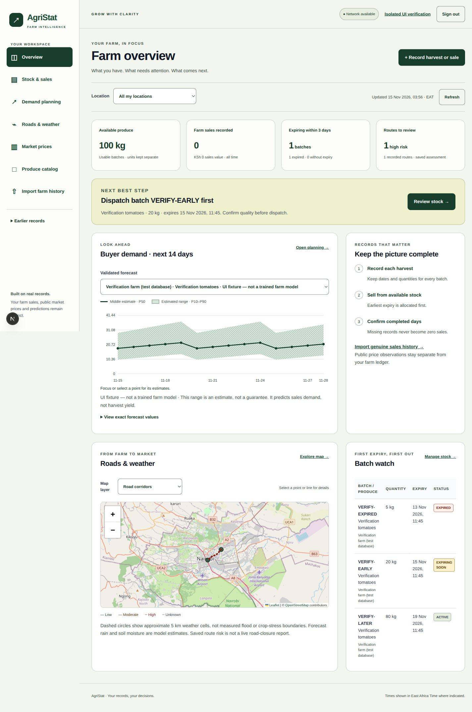

# AgriStat

AgriStat helps a farm track harvested produce, record sales, compare public market prices and plan using demand forecasts, weather and road information.

**Phase 3 milestone:** PostgreSQL infrastructure, farm operations and planning, plus a responsive Next.js dashboard. Real farm records, published market observations and predictions remain separate. The application does not invent sales or stock when records are missing.

## Start here

- [Setup and daily startup](GET_STARTED.md)
- [How every component works](docs/HOW_AGRISTAT_WORKS.md)
- [Phase 1: data infrastructure and live sources](docs/PHASE1.md)
- [Phase 2: farm operations and forecasting](docs/PHASE2.md)
- [Phase 3: dashboard guide and screenshots](docs/PHASE3.md)
- [Deployment and verification](DEPLOYMENT.md)

## What is implemented

- PostgreSQL 16 with PostGIS and TimescaleDB, migrations, Redis, Celery workers and schedules.
- Public Kenyan market-price imports with provenance; Open-Meteo weather; local Kenya Overpass road inspection and external OSRM routing.
- Harvest batches, expiry checks and atomic sales with first-expiry-first-out allocation and retry protection.
- Confirmed daily demand history, LightGBM quantile and Prophet validation, dynamic lead times and shelf-life-aware reorder suggestions.
- Next.js web workspace with responsive layouts, forecast bands, road/weather maps, action prompts and checked administrator CSV imports.

The `mobile/` directory contains an earlier Flutter client. The blueprint's offline-first Phase 4 workflow is not yet complete. Forecast accuracy for a real farm requires real historical records and validation; the screenshot is not evidence of a trained farm model.

## Repository layout

| Directory | Responsibility |
| --- | --- |
| `backend/app/` | FastAPI endpoints, data models, business services and workers |
| `backend/tests/` | API, business-rule and PostgreSQL integration tests |
| `alembic/` | Versioned database migrations |
| `infra/` | Docker Compose, application image and resumable Kenya download |
| `web/` | Next.js-hosted React workspace and contrast checks |
| `mobile/` | Existing Flutter client; Phase 4 work remains |
| `docs/` | Phase guides, infrastructure explanations and screenshots |

## Verification

The GitHub workflow runs backend tests with PostgreSQL/PostGIS/TimescaleDB, web contrast checks and a production build. Local verification details and limitations are recorded in the phase guides. The web app retains React Router as an incremental Next.js migration bridge.

## Milestone process

At the end of each phase: finish implementation, run relevant tests, verify the running workflows, update the guides and useful screenshots, then commit and push the milestone. Keep credentials, downloaded datasets, local databases and scratch logs out of Git. Screenshots using test records must say so.
