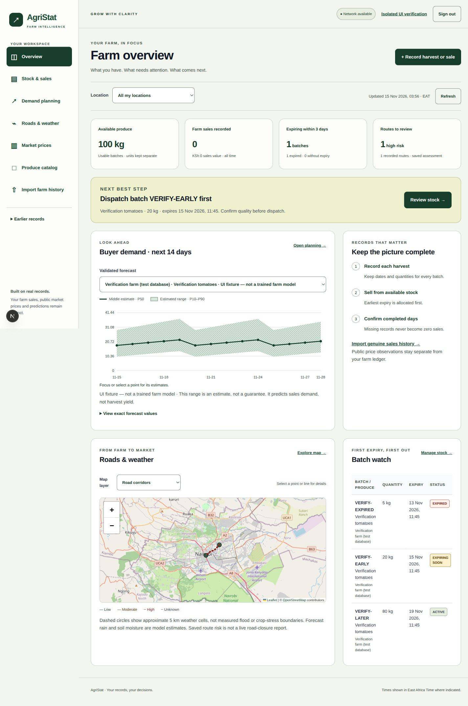
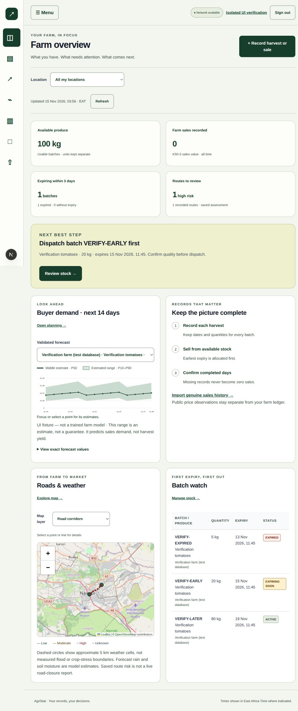
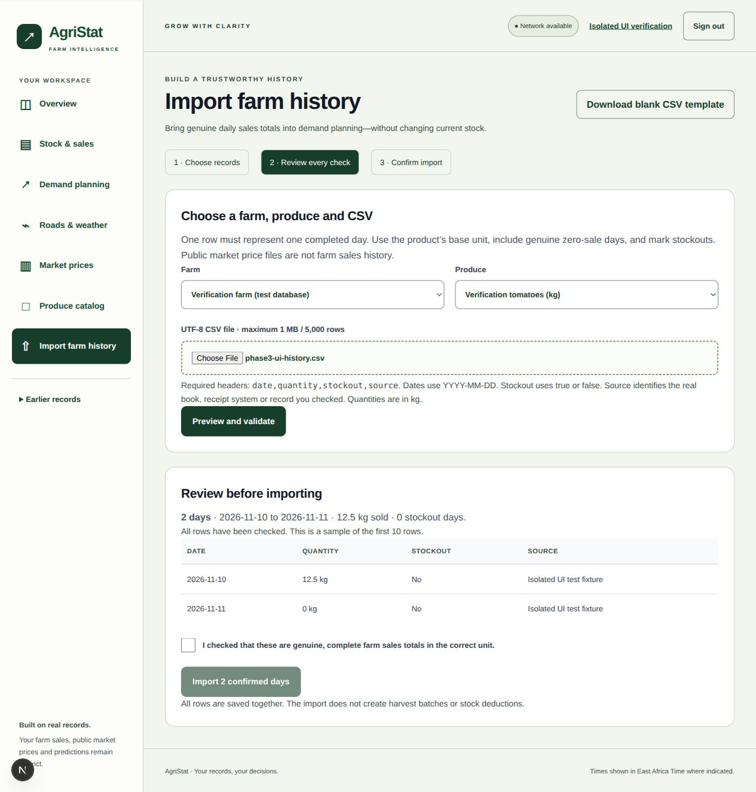
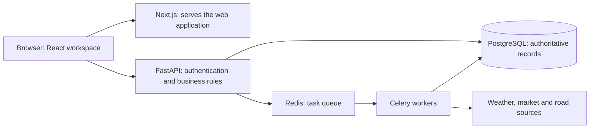
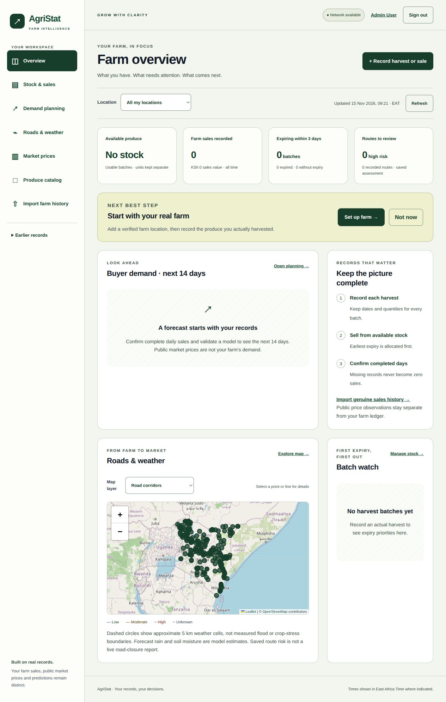
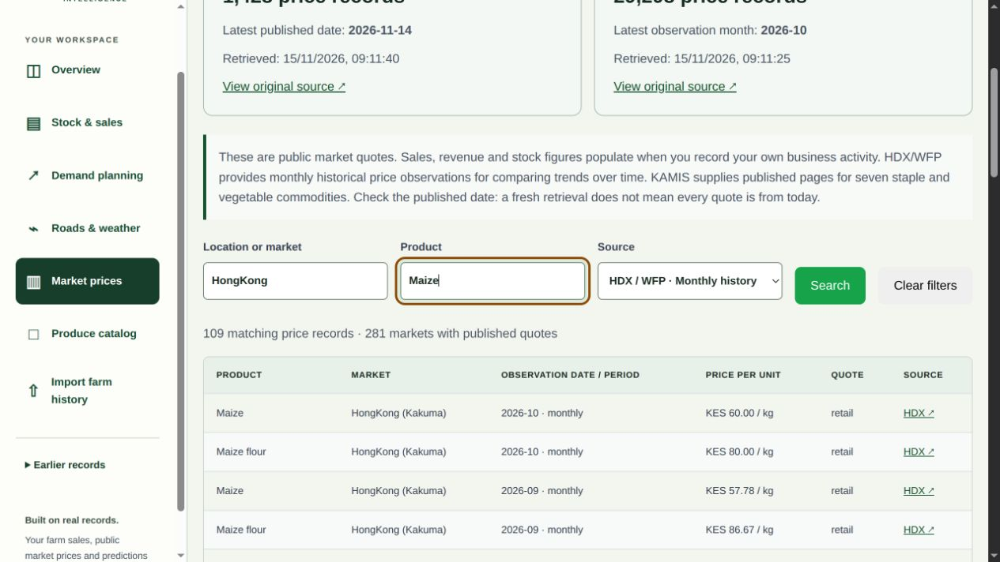

# Phase 3 — responsive farm dashboard

Phase 3 adds the web workspace for a farm selling its produce. The browser now runs through Next.js. PostgreSQL remains the source of business records, and FastAPI continues to validate every authenticated request.

## What each screen does

| Screen | Purpose | Where the figures come from |
| --- | --- | --- |
| Overview | Available stock, sales totals, expiry priorities and next actions | Your organization's farm ledger; quantities stay separate by unit |
| Stock & sales | Record actual harvest batches and sales | PostgreSQL transactions, including FEFO stock allocation |
| Demand planning | Confirm daily history, validate models and review recommendations | Confirmed sales history, weather and saved model runs |
| Roads & weather | Explore known locations, inspected corridors and weather estimates | Saved road inspections and weather observations |
| Market prices | Compare published observations with their source dates | Published KAMIS quotes and HDX/WFP monthly history; never private farm sales |
| Import farm history | Preview and import genuine historical daily totals | Administrator-selected CSV, validated before saving |

Earlier screens remain accessible under **Earlier records**. Their legacy transaction ledger is separate from the farm ledger; the overview does not silently combine them.

## Reading the overview

Available produce excludes expired, synthetic, future-received and inactive-product batches. Kilograms and individual units are not added together. Sales count and value refer to recorded farm sales, not public market prices or imported daily demand totals.

The next-action card provides a choice: open the relevant workflow, or choose **Not now** to hide the suggestion until the overview refreshes. Hiding a card does not mark work completed or change stock. Review quality before dispatching any produce.

The layout uses a 12-column desktop grid, two-column tablet panels and a compact phone layout. Tablet navigation collapses to an icon rail; Menu expands its labels. The phone layout uses a menu drawer. Tables scroll within their panels.

The following screenshots contain **isolated verification fixtures**, not operational farm records. The example forecast explicitly identifies itself as a UI fixture, not a trained model.





## Understanding the forecast

The dark line is P50, the middle estimate. The shaded P10–P90 band shows lower and upper predictive quantiles. Select a point to read its values, or expand **View exact forecast values** for a table. These are estimates of buyer demand, not harvest yield or guaranteed sales.

The overview only displays validated runs whose forecast starts today. Missing history produces an explanation rather than fabricated numbers. A model requires at least 120 consecutive confirmed daily totals, including genuine zero-sale days and stockout indicators. UI screenshots do not establish forecast accuracy for a real farm.

## Understanding the map

Road corridors display stored route geometry and saved risk assessments. High risk is a review signal, not proof of a road closure. The road inspection timestamp and unknown-surface fraction help judge the evidence.

Switch between road corridors, three-day rainfall and estimated soil moisture. Weather circles approximate five-kilometre cells; they are not measured flood boundaries. Rainfall requires all three forecast days with non-null readings retrieved within 36 hours. Incomplete or stale data displays as unknown, not zero. Locations without coordinates stay in the records but are not placed at invented map positions.

The map background comes from OpenStreetMap tiles. Local Overpass supplies road-tag queries; it does not serve the background tiles or replace OSRM route generation. An internet connection is still needed for those external services. Tables remain available if map tiles fail.

## Importing real farm history

1. Open **Import farm history** as an administrator.
2. Choose the farm and produce. Quantities must use that product's base unit.
3. Download the blank template and fill one row for each completed day. Required headers are `date,quantity,stockout,source`.
4. Use `YYYY-MM-DD` dates, non-negative quantities, `true` or `false` for stockout, and a source identifying the actual book or receipt system checked. A zero-sale day is a confirmed fact; an absent day remains missing.
5. Select the UTF-8 CSV and choose **Preview and validate**. Limits are 1 MB and 5,000 data rows. Every row is checked; the page displays a sample of up to ten rows.
6. Correct any errors. Existing dates and duplicate dates are rejected, never overwritten.
7. Confirm that the totals and units are correct, then choose **Import confirmed days**.



Previewing writes nothing. The API binds the preview to the file contents, farm and product. Confirmation revalidates the file and inserts all rows in one database transaction; a failure saves none. Imported totals become demand-history records. They do not create harvest stock, sales receipts or retrospective stock deductions.

## How the web infrastructure fits together



Next.js replaces Vite for development and production builds. This is an incremental migration: a Next.js catch-all page loads the existing client application, which retains React Router and browser token storage. It does not yet move authentication or business-data fetching to server components. FastAPI still enforces access rules; hiding a menu item is not a security boundary.

The three new API endpoints are `GET /api/v1/dashboard`, `GET /api/v1/map-data` and administrator-only `POST /api/v1/admin/import-csv`. They use existing tables; Phase 3 introduces no additional database migration. The previous migration head remains `0005_planning`.

## Run and verify

From the repository root, rebuild the API and workers after backend changes:

```bash
sudo docker compose --env-file infra/.env -f infra/compose.yaml up --build -d
sudo docker compose --env-file infra/.env -f infra/compose.yaml ps -a
```

In a separate terminal:

```bash
cd web
npm ci
npm test
npm run build
npm start
```

Open [the dashboard](http://localhost:5173/dashboard). For development, use `npm run dev` instead of `npm start`; do not run both on port 5173. Set `NEXT_PUBLIC_API_URL=http://localhost:8001/api` in ignored `web/.env.local` before building. Existing `VITE_API_URL` is temporarily accepted for migration compatibility.

## Verification and boundaries

On 15 November 2026, the foundation, sales, planning and dashboard regression suite passed 83 tests. A further run passed 40 PostgreSQL, authentication, product and dashboard tests, including the new stale-weather check; these suites overlap and their counts should not be added. Three tests exercised actual PostgreSQL extensions, concurrency and retry behavior in isolated test schemas.

The Next.js production build and six core text-contrast checks passed. The dependency audit reported no known vulnerabilities at verification time. Browser checks covered CSV preview/confirmation, desktop/tablet/phone layouts and the map/forecast controls. Test records were confined to a separate SQLite database.

The six tested text/background pairs meet 7:1. This is not a claim that every legacy screen or third-party map control has received a complete accessibility audit. React 18 remains compatible with the installed Next.js release but generates a deprecation warning; a future upgrade should address it before moving to Next.js 17.

Phase 4 adds offline mobile synchronization. Phase 3 does not queue offline sales. Production HTTPS, database row-level security and observability remain Phase 5 work.

## Deployed milestone check

On 15 November 2026, after rebuilding the Docker stack, all three Phase 3 endpoints were present in OpenAPI. Authenticated overview and map requests returned HTTP 200 against PostgreSQL. The operational ledger contained zero farm sales, zero harvest batches and zero farms; the map endpoint retained 281 existing locations. No demonstration farm records were imported into that database. The Next.js production server runs on port 5173.

The deployed overview below shows the actual empty farm ledger alongside existing public location data. Sign-out, sign-in and the action-card dismissal were also verified.



## Market search — location, product and source

Use **Location or market** and **Product** together to narrow results. Both are case-insensitive partial-name searches and both must match when entered. The redundant combined search field has been removed. **Clear filters** resets both search fields and the source selection.

**All sources** includes KAMIS and HDX/WFP. Choose **KAMIS** for its published market quotes or **HDX / WFP · Monthly history** for historical monthly observations. Both sources participate in manual and scheduled refreshes. Existing HDX records were retained and are available again.

HDX rows show their observation month explicitly, rather than implying a daily quote. Its source card displays the latest observation month separately from the retrieval timestamp. KAMIS rows retain their published dates. Recent retrieval does not imply that all observations describe today's prices. Neither source supplies your farm's private sales or inventory.

Searches apply before pagination across stored observations. The market count represents distinct locations with observations across the sources. Source coverage and available products differ; an empty result means no stored quotes match those filters.



Restoration verified on 15 November 2026: the deployed API returned both source summaries (29,298 HDX/WFP observations and 1,428 KAMIS quotes). A HongKong market + Maize search returned 109 monthly HDX observations, including partial-name matches such as maize flour. The 31 foundation tests, production build and six contrast checks passed.
